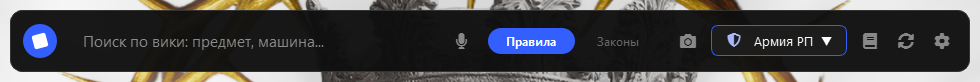
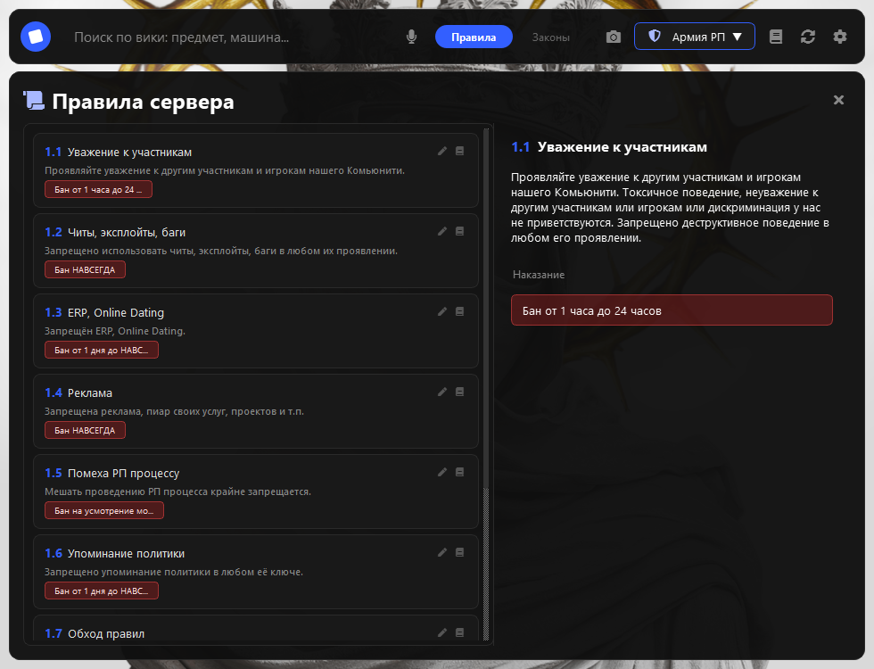
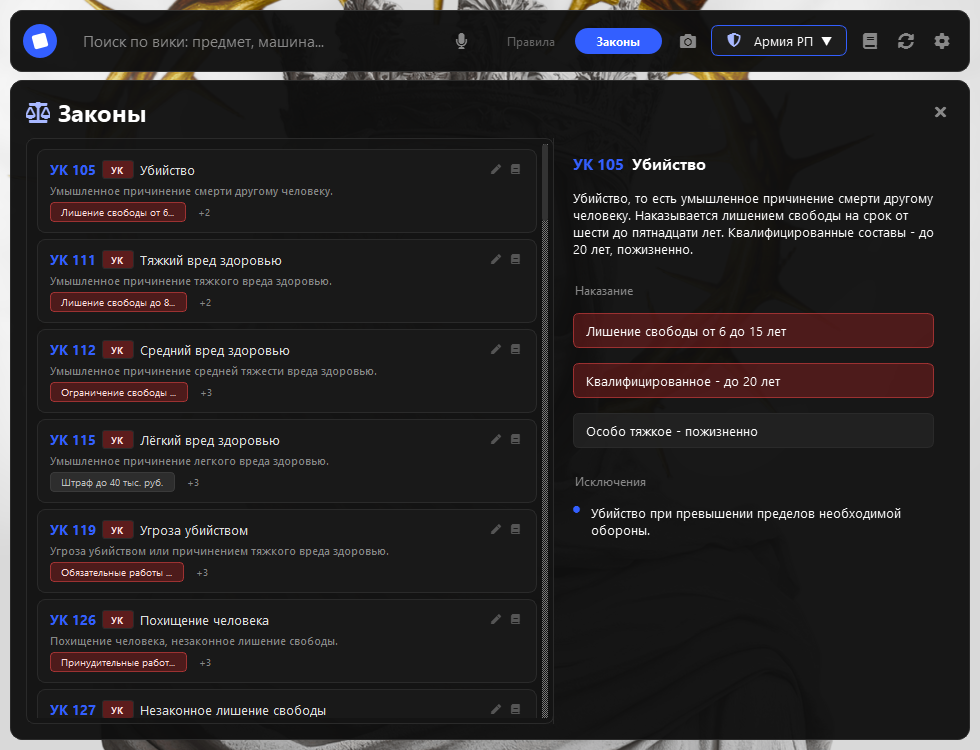

# 🎮 Pluck Remorked

**Это - ДРУГАЯ программа, если ты хочешь скачать оригинал**

github.com/skzysz/Pluck

Быстрый поиск по правилам сервера, законам штата и правилам для администрации — прямо поверх игры, без переключения окон.

[Возможности](#возможности) • [Скриншоты](#скриншоты)

---

## О проекте

**Pluck Remorked** - это десктопное приложение, которое отображается **поверх окна Roblox (или любого другого приложения)** и позволяет мгновенно находить нужную информацию: правила сервера, статьи УК/КоАП/ПДД или правила для покупной администрации.

Больше **не нужно** сворачивать игру, чтобы вспомнить пункт правил - просто введи запрос в поиск и получи ответ.

---

## Возможности

- 🔍 **Мгновенный поиск** по правилам, законам и админ-правилам (debounce 150 мс).
- 📚 **Три раздела** в одном окне: Правила • Законы • Админам.
- 📌 **Закрепление поверх всех окон** одной кнопкой (или открепление — чтобы не мешать кликам).
- 🎬 **Плавные анимации** .
- 🏷️ **Умные теги наказаний** — жёсткие (бан, лишение свободы) подсвечиваются красным, мягкие (штраф, предупреждение) — серым.
- 🖱️ **Перетаскивание окна** мышью, как в игре.
- ⚙️ **Настройки**: запуск с Windows, окно поверх всех, запуск свёрнутым.
- 🔄 **Перезапуск** прямо из панели одной кнопкой.
- 🚀 **Автозагрузка** при входе в Windows (через реестр).

---

## Скриншоты

**Верхняя панель (свёрнутое состояние):**

**Раздел «Правила сервера»:**

**Раздел «Законы»:**

**Настройки:**

---
